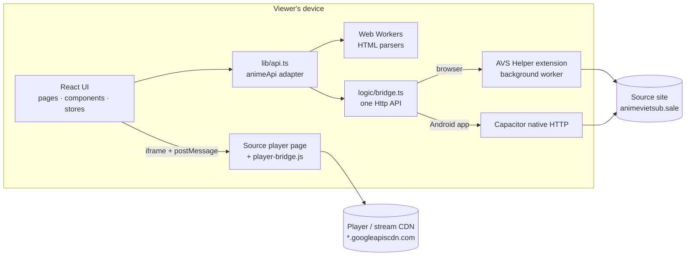

<div align="center">

# 🎬 Capynime

**Watch Vietsub anime fast and clean, with no backend.**

A web app plus an Android app. Every request goes straight from the viewer's own device.

[](../../releases/latest)


</div>

---

## ✨ Features

- 🏠 **Home**: featured slider, top 10, smooth lazy-loaded shelves.
- 🔎 **Explore** by genre, fast search, watch history and favorites.
- ▶️ **The app's own player**, drawn over the source player, one UI on every device:
  - Double tap either side to seek ±10 s, swipe sideways to scrub.
  - Full screen: swipe up/down on the right for volume, on the left for brightness.
  - Speed and episode menus open as **drop-up popups** anchored to their button (desktop).
  - **Cinema mode**: centered, grows smoothly, shortcut `T`.
  - Desktop shortcuts: `Space`/`K` play/pause, `←` `→` seek, `↑` `↓` volume, `M` mute, `F` full screen, `T` cinema mode.
  - Remembers the position of every episode ("Continue watching"), next-episode card, skip intro.
- 🛡️ **Ad blocking** at the network layer and inside the player page.
- 📱 **PWA** on the web and an **Android app** (no extension needed).

## 🧱 Structure

| Folder | What | License |
|---|---|---|
| [`frontend-vite/`](frontend-vite/) | Vite + React + TypeScript web app, also the base of the Android app (Capacitor) | GPL-3.0-only (see `NOTICE.md`) |
| [`avs-helper-extension/`](avs-helper-extension/) | Chrome/Edge extension (Manifest V3) the web build needs | MIT |

## 🏗️ Architecture

There is no backend. The app only ever talks to the source site, and it does so from the viewer's own device,
through one of two transports that expose the same `Http.get / Http.post` API.



### Web app (`frontend-vite/src`)

| Path | Role |
|---|---|
| `pages/` | One lazy route per page: `home`, `explore`, `search`, `watch`, `history`, `favorites`. Routes are listed in `lib/routes.ts` and preloaded on hover/touch. |
| `components/` | `home/` slider and shelves, `layout/` header, sidebar dock, extension gate, `movie/` cards and detail views, `player/` the video player UI, `lightswind/` small UI primitives. |
| `lib/api.ts` | The `animeApi` adapter the UI calls. It turns source pages into typed data and builds the player `embedUrl`. |
| `apis/runs`, `apis/parser`, `apis/workers` | One module per source endpoint. A `run` does the request, a `parser` turns HTML into data, and parsing runs in a Web Worker (`wrap-worker.ts`). |
| `logic/` | Transport (`bridge.ts`, `http.ts`), HLS loading and decryption, native volume/brightness, Android back button, skip-intro times. |
| `stores/`, `contexts/` | Zustand stores (UI, player, history) and React contexts. |
| `hooks/` | `usePlayerBridge` (remote control of the player frame), data hooks, debounce, local storage. |
| `constants.ts` | `HOST_CURL`, the single source host everything derives from. |

State and data: TanStack Query caches catalog answers and persists them to IndexedDB (`idb-keyval`), so returning
viewers see pages at once while they refresh. Zustand holds UI/player state. Watch history, favorites and episode
positions live in the browser's local storage.

### Player

1. `watch.tsx` asks `lib/api.ts` for the episode; the source answers with a link to its player page.
2. `CinemaPlayer.tsx` embeds that page in an `<iframe>` (`embedUrl`, tagged `#animevsub-vsub_extra`, so the Referer is added).
3. `public/player-bridge.js` runs inside the frame. It neutralizes the player's ads, hides its own controls and
   exposes a `postMessage` remote control (play, pause, seek, rate, volume, resume) plus a state feed.
4. `usePlayerBridge` talks to the bridge; `TouchControls.tsx` draws the app's controls (gestures, shortcuts,
   drop-up menus, cinema mode) and sends commands through it.
5. If the source ever answers with a plain stream instead of its iframe, `HlsPlayer.ts` plays it with a patched hls.js.

The bridge is injected by the extension (content script) on the web and by `MainActivity.java` in the Android app.

### Extension (`avs-helper-extension`)

| Path | Role |
|---|---|
| `lib/background/` | Manifest V3 service worker. Performs the fetches the page asks for and installs the `declarativeNetRequest` rules: `create-rule.ts` (Referer/Origin/User-Agent by URL tag, CORS headers), `ad-rules.ts` (ad domains), `install-referers.ts`. |
| `lib/contentScripts/` | Runs on allowlisted hosts. Relays `http:request` DOM events from the page to the worker and the answer back as `http:response`. |
| `manifest-v3/` | Build setup (`src/manifest.ts` generates `manifest.json`, `tsup` bundles to `extension/dist`). Also holds `assets/player-bridge.js` for the player frame. |
| `allowlist.yaml` | Hosts allowed to use the bridge (content-script matches). |
| `map-referer.json` | URL tag → Referer the extension sends. Keep it equal to `HOST_CURL`. |

URL tags are how the app asks for header changes: `#animevsub-vsub` sends the source Referer, `..._extra` also adds
CORS headers so images and HLS segments can be fetched by the page itself.

### Android app (`frontend-vite/android`)

Capacitor wraps the same built web app. `bridge.ts` swaps the extension for Capacitor's native HTTP, and
`capacitor.config.ts` serves the bundle under the source host so the embedded player sees the right Referer.
`MainActivity.java` injects `player-bridge.js`, blocks ad URLs in the WebView, and implements native full screen,
volume and brightness.

## 🚀 Run

```sh
# 1. Build the extension, then load avs-helper-extension/manifest-v3/extension as "Load unpacked"
cd avs-helper-extension && pnpm i && pnpm build

# 2. Start the web app
cd ../frontend-vite && pnpm i && pnpm dev      # http://localhost:4100
```

After rebuilding the extension, **reload** it in `chrome://extensions`.

| Command (in `frontend-vite`) | What it does |
|---|---|
| `pnpm test` | Run the specs (Vitest) |
| `pnpm lint` | Biome, errors only |
| `pnpm build` | Type-check and build to `dist/` |
| `pnpm build:apk` | Debug APK |
| `pnpm release [patch\|minor\|major]` | Bump the version, build the signed APK + AAB into `release/` |

> `pnpm release` needs JDK 21 and `android/keystore.properties`. Details in [frontend-vite/README.md](frontend-vite/README.md).

## 📲 Install the Android app

Download the latest `.apk` from **[Releases](../../releases/latest)** and install it. The phone warns about any APK
installed outside Google Play; that is normal. If the install fails, the copy already installed is usually signed
with a different key: uninstall it and install again.

## 🌐 Deploy

The web app is static files (`pnpm build` → `frontend-vite/dist`); rewrite every path to `index.html`
(`vercel.json` already does this for Vercel). The server never contacts the source site, so its IP does not matter.

The extension only works on the hosts listed in [`avs-helper-extension/allowlist.yaml`](avs-helper-extension/allowlist.yaml):
add the production host there, rebuild, and have viewers install that build.

## 🔗 Source host

The source host is currently `animevietsub.sale` (player on `*.googleapiscdn.com`). To change it, update all of:

1. `frontend-vite/src/constants.ts`
2. `frontend-vite/capacitor.config.ts`
3. `avs-helper-extension/map-referer.json`

then rebuild the extension and the app.

## ⚖️ License

Web app: GPL-3.0-only, because the data and player layers are derived from `anime-vsub/desktop-web`. Extension: MIT.
