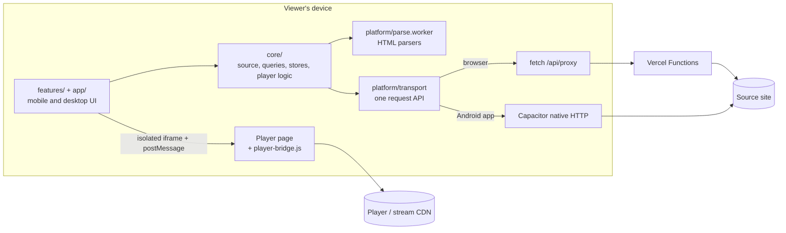

<div align="center">


# Capynime

**A fast, clean client for watching Vietsub anime. Vercel web app and native Android shell.**

[Download for Android](https://github.com/CodeForFee/anime-cinema-vite/releases/latest)
&nbsp;·&nbsp;
[Architecture](#architecture)
&nbsp;·&nbsp;
[Getting started](#getting-started)
&nbsp;·&nbsp;
[Configuration](#configuration)

<br />

&nbsp;
&nbsp;
&nbsp;
&nbsp;
&nbsp;


</div>

---

## Table of contents

- [Overview](#overview)
- [Features](#features)
- [Repository layout](#repository-layout)
- [Architecture](#architecture)
- [Getting started](#getting-started)
- [Android app](#android-app)
- [Deployment](#deployment)
- [Configuration](#configuration)
- [Disclaimer](#disclaimer)
- [License](#license)

## Overview

Capynime uses AnimeVietsub as its source. On this experimental branch, the web app calls same-origin Vercel
Functions for source HTML/JSON and an isolated player page; Android still requests the source from the viewer's
device. No separately operated backend is required. Real extension-free playback remains subject to the
[Preview verification gate](frontend-vite/SERVERLESS.md).

It ships in two forms that share one code base:

| Form | How requests are made | Install |
|---|---|---|
| Web app (PWA) | Same-project **Vercel Functions** | Open the Vercel deployment; no extension transport |
| Android app | Through Capacitor's native HTTP stack | Install the APK from [Releases](https://github.com/CodeForFee/anime-cinema-vite/releases/latest) |

## Features

**Browsing**
- Home with a featured slider, a top 10 and lazy-loaded shelves.
- Explore by genre, search, watch history and favorites.

**Player** (the app draws its own controls over the source player, the same on every device)
- Double tap either side to seek 10 s, swipe sideways to scrub.
- In full screen, swipe vertically on the right for volume and on the left for brightness.
- Speed and episode menus open as drop-up popups anchored to their button on desktop.
- Cinema mode that grows the player smoothly and keeps it centered.
- Per-episode resume position, next-episode card and skip intro.

**Desktop keyboard shortcuts**

| Key | Action | Key | Action |
|---|---|---|---|
| `Space` / `K` | Play or pause | `M` | Mute |
| `←` / `→` | Seek 10 s | `F` | Full screen |
| `↑` / `↓` | Volume | `T` | Cinema mode |

**Other**
- Player-page ad cleanup; Android also blocks ad requests at the network layer.
- Catalog answers are cached in IndexedDB, so returning viewers see pages immediately.

## Repository layout

| Folder | Contents | License |
|---|---|---|
| [`frontend-vite/`](frontend-vite/) | Vite + React + TypeScript web app and the Capacitor Android project | GPL-3.0-only |
| [`avs-helper-extension/`](avs-helper-extension/) | Legacy Chrome / Edge helper (unchanged on this branch) | MIT |

## Architecture

The core uses one request API (`src/platform/transport.ts`, installed by `configureCore`). On web it calls
`/api/proxy`; on Android it uses native HTTP. Functions only accept configured source/player destinations,
validate redirects, bound responses and do not forward application cookies or relay video segments.



### Web app (`frontend-vite/src`)

Five layers; each imports only the ones above it in this table, and `src/architecture.spec.ts` fails the tests
when one does not (it also keeps `mobile/` and `desktop/` apart and component files under 250 lines).

| Layer | Responsibility |
|---|---|
| `core/` | Platform-free logic, ready to share with a native app: `source/` (hosts, domain failover, one folder per source page with `fetch.ts` + `parse.ts`), `anime-api.ts`, `queries.ts` (TanStack Query options), `stores/`, `player/` (resume, episode pick, skip times, quality policy), `hd-art.ts`. No DOM, no Capacitor. |
| `platform/` | Adapters: transport (extension or native HTTP), the long-lived parser worker, IndexedDB art cache, Android back button, network, haptics. `install.ts` wires them into the core before anything else runs. |
| `shared/` | UI primitives (`ui/`: button, badge, `dialog` for desktop, `sheet` for mobile, …) and helpers (`lib/`: `cn`, `useFormFactor`). |
| `features/` | `home`, `browse`, `title`, `player`, `library`. Each has `mobile/` and `desktop/` (the UI of one form only), `components/` (shared JSX), `hooks/`, `model/` (pure functions with specs) and an `index.ts` other features import from. |
| `app/` | Shell, layout (`layout/mobile`, `layout/desktop`), TanStack Router routes, query client. |

**Mobile and desktop are separate.** `useFormFactor()` is the one place that decides (`pointer: coarse` or under
1024 px is mobile). Each form lazy-loads only its own chunks: a phone never downloads the desktop header, hero,
title modal or player controls, and the other way round.

**Routing.** TanStack Router with typed search params (`/watch?slug&ep`, `/explore?path`, `/search?q`). A tap
starts the page's data (detail, then the episode's stream) before the page mounts; hovering only fetches the code.
Every history move animates with a View Transition whose type (`push`, `pop`, `tab`, `up`, `down`) comes from
`navKind` and the history index, so the browser's Back button and Android's back gesture slide the right way.

**Source domains.** The source moves domains often. `core/source/hosts.json` lists the current host, the hosts that
redirect to it and the look-alike sites to refuse. Every request has a timeout. When the host dies, one parallel
probe of the official link and every known host picks a new one, but only through trusted redirects to a page with
the source's own markup. The failed requests are then retried there, with no reload and no error shown. See
[`docs/SOURCE-DOMAINS.md`](docs/SOURCE-DOMAINS.md).

State: TanStack Query caches catalog answers and persists them to IndexedDB; Zustand holds UI and player state
(the quality choice is kept on the device); history, favorites and episode positions live in local storage.

### Player pipeline

1. `/watch` asks the core for the episode; on web, `/api/proxy` performs the source request.
2. On web, `CinemaPlayer.tsx` loads `/api/player` in a sandbox without `allow-same-origin`. The Function fetches only an allowed player URL, fixes its asset base and injects an absolute bridge script. Android still embeds the original URL and injects natively.
3. `public/player-bridge.js` runs inside the frame. It removes in-player overlays, hides the player's controls after the handshake and reports playback state and quality through `postMessage`.
4. `engines/iframe-bridge.ts` checks the exact iframe window and per-load channel for an opaque web frame, or the original player origin for native playback. Mobile and desktop controls share the protocol.
5. Quality follows "Tự động + gợi ý" (`core/player/pick-quality.ts`). The player's automatic choice is the default, and Data Saver caps it at 480p. Two stalls over a second within a minute bring up a one-tap "Mạng yếu · Chuyển 480p". The viewer's choice is applied to every episode. Cover lookups wait while the video is short of buffer.
6. If the source ever answers with a plain stream instead of its iframe player, `engines/hls/HlsPlayer.ts` plays it with a patched hls.js. That path starts from the browser's bandwidth estimate, buffers a minute ahead, retries with backoff and resumes when the connection returns.

The web Function injects the bridge; `MainActivity.java` injects it in Android. Injection does not make CDN
playlist/segment requests same-origin, grant upstream sessions, or guarantee playback. See the Preview gate.

### Legacy extension (`avs-helper-extension`)

Preserved unchanged for existing builds; the web transport on this branch does not use it.

| Path | Responsibility |
|---|---|
| `lib/background/` | Manifest V3 service worker. Performs the fetches the page asks for and installs the `declarativeNetRequest` rules: `create-rule.ts` (Referer, Origin and User-Agent by URL tag, CORS headers), `ad-rules.ts` (ad domains), `install-referers.ts`. |
| `lib/contentScripts/` | Runs on allowlisted hosts. Relays `http:request` DOM events from the page to the worker and the answer back as `http:response`. |
| `manifest-v3/` | Build setup: `src/manifest.ts` generates `manifest.json`, `tsup` bundles into `extension/dist`. Also holds `assets/player-bridge.js`. |
| `allowlist.yaml` | Hosts allowed to use the bridge. |
| `map-referer.json` | URL tag to Referer map. Must match `HOST_CURL`. |

URL tags are how the app asks for header changes: `#animevsub-vsub` sends the source Referer, and `..._extra` also
adds CORS headers so the page can fetch images and HLS segments itself.

### Android shell (`frontend-vite/android`)

Capacitor wraps the same built web app. `src/platform/transport.ts` swaps the extension for Capacitor's native HTTP, and
`capacitor.config.ts` serves the bundle under the source host so the embedded player receives the right Referer.
`MainActivity.java` injects `player-bridge.js`, blocks ad URLs in the WebView, asks for the screen's fastest refresh
rate (90/120 Hz, handed back to the system in full-screen video) and implements native full screen, volume and brightness.

## Getting started

**Requirements:** Node.js 22.12 or newer, pnpm 11, a browser and a Vercel project for the full web runtime.

```sh
cd frontend-vite
pnpm install
cd ..              # Vercel CLI uses repository root; Root Directory is frontend-vite
npx vercel dev      # web + same-origin /api/*
```

`pnpm dev` serves only the Vite UI; it does not run the Functions. Link the existing Vercel project before using
`vercel dev`. Deployment and acceptance checks are in [`frontend-vite/SERVERLESS.md`](frontend-vite/SERVERLESS.md).

**Scripts** (run in `frontend-vite`)

| Command | Description |
|---|---|
| `pnpm dev` | Start the dev server |
| `pnpm build` | Type-check and build to `dist/` |
| `pnpm test` | Run the specs with Vitest |
| `pnpm lint` | Lint with Biome (errors only) |
| `pnpm analyze` | Build and write the bundle report to `dist/stats.html` |
| `pnpm build:apk` | Build a debug APK |
| `pnpm release [patch\|minor\|major]` | Bump the version and build the signed APK and AAB into `release/` |

## Android app

Download the latest `.apk` from [Releases](https://github.com/CodeForFee/anime-cinema-vite/releases/latest) and
install it. No extension is needed. Android warns about any APK installed outside Google Play; that is expected for
sideloading. If an install fails, the copy already on the phone is usually signed with a different key: uninstall
it and install again.

**Building a release** requires JDK 21, the Android SDK and a signing key (`android/keystore.properties` and
`android/capynime-release.jks`, both git-ignored). `pnpm release` bumps the version in `package.json`, builds, signs
and copies `Capynime-<version>.apk` and `.aab` into `frontend-vite/release/`. Commit `package.json` afterwards, and
keep a backup of the keystore: without it, installed apps can no longer be updated. More detail in
[`frontend-vite/README.md`](frontend-vite/README.md).

## Deployment

Deploy with Vercel Root Directory `frontend-vite`: `pnpm build` produces the SPA and Vercel discovers `api/`
beside it. SPA and service-worker fallbacks exclude API paths. This web branch requires Functions, not just a
static `dist/` host. Upstream sees Vercel's IP for source/player HTML, so Cloudflare and session checks must be
verified on Preview. The browser still loads CDN media directly; no extension installation is required by the transport.

## Configuration

| Setting | File | Purpose |
|---|---|---|
| Source hosts | `frontend-vite/src/core/source/hosts.json` | Current host, hosts that redirect to it, look-alikes to refuse; the app switches on its own at runtime |
| Source host (Android) | `frontend-vite/capacitor.config.ts` (`server.hostname`) | The origin the app is served under; changing it loses local storage |
| Referer map | `avs-helper-extension/map-referer.json` | The Referer the extension sends with source requests |
| Allowed web hosts | `avs-helper-extension/allowlist.yaml` | Hosts that may use the extension bridge |
| Player host | `avs-helper-extension/manifest-v3/src/manifest.ts`, `lib/background/logic/ad-rules.ts`, `MainActivity.java` | The player CDN (`*.googleapiscdn.com`) the bridge and ad rules apply to |

After changing any of these, rebuild the extension and the app. Known alternate source domains, the official
announcement channels and the exact switch steps are in [`docs/SOURCE-DOMAINS.md`](docs/SOURCE-DOMAINS.md); run
`pnpm domains` in `frontend-vite` to see which host is current.

## Disclaimer

Capynime hosts no media and operates no persistent servers. Vercel Functions relay source HTML/JSON. It loads content from a third-party site the user
chooses to visit. It is not affiliated with that site, and users are responsible for how they use it and for
complying with the laws that apply to them.

## License

The web app is licensed under **GPL-3.0-only**, as its data and player layers are derived from
[`anime-vsub/desktop-web`](https://github.com/anime-vsub/desktop-web). The extension is a fork of
[`anime-vsub/extension-animevsub-helper`](https://github.com/anime-vsub/extension-animevsub-helper) and is licensed under **MIT**.
See `frontend-vite/NOTICE.md` and `avs-helper-extension/LICENSE`.
